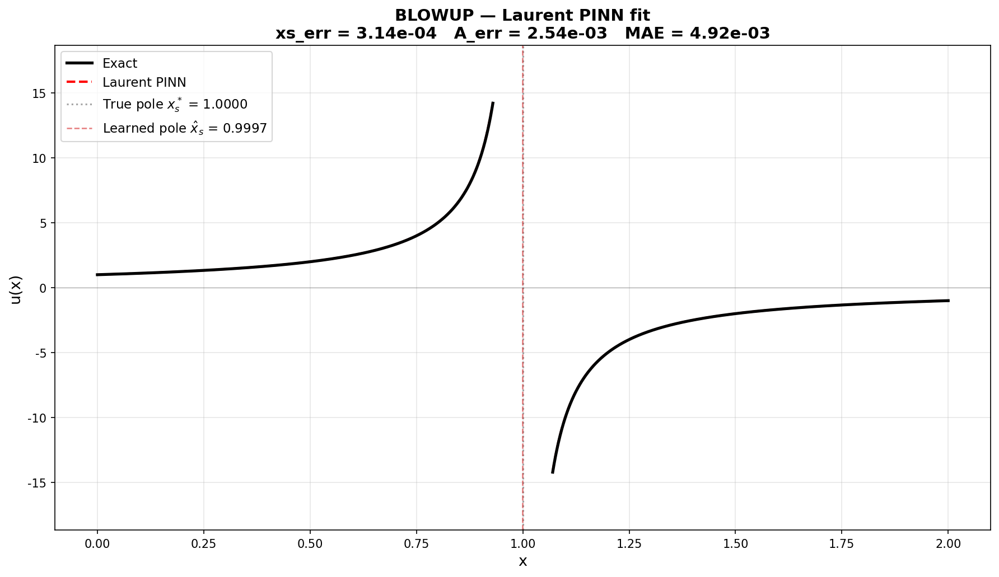
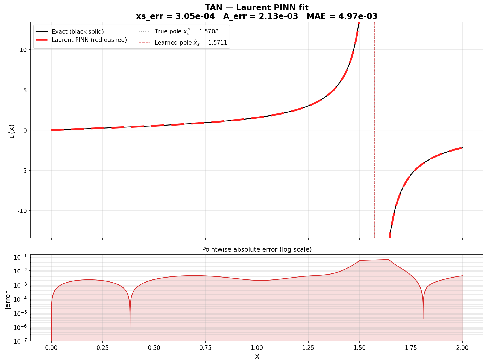
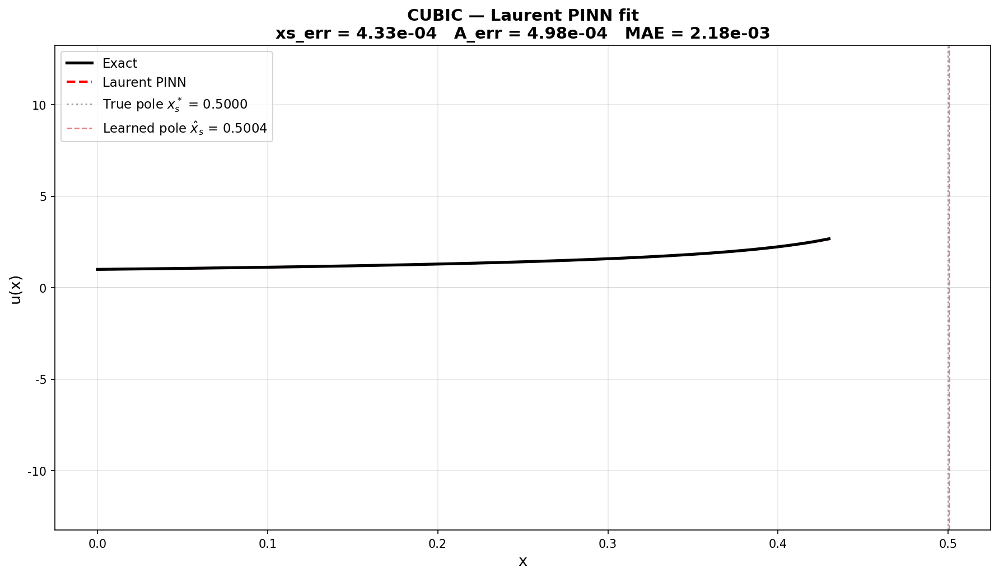
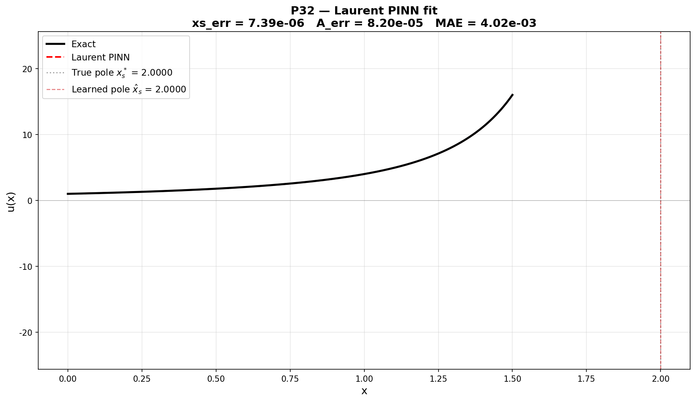
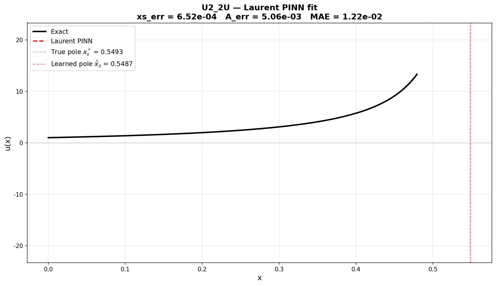
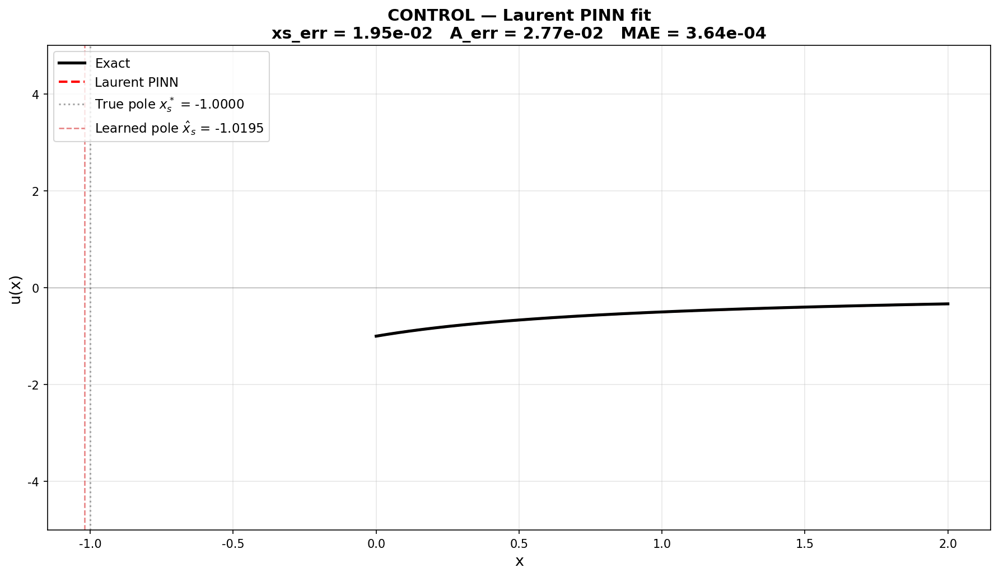
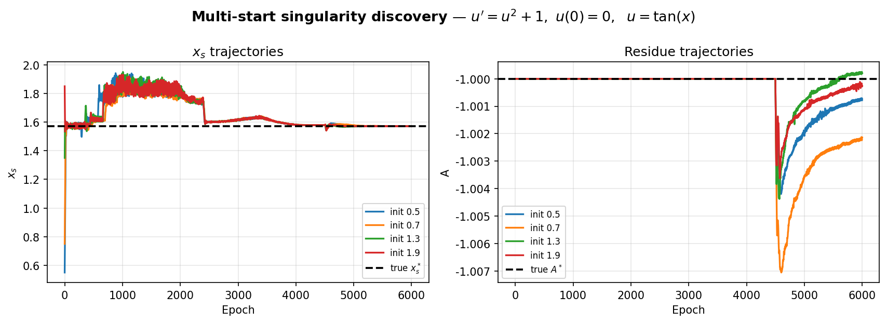
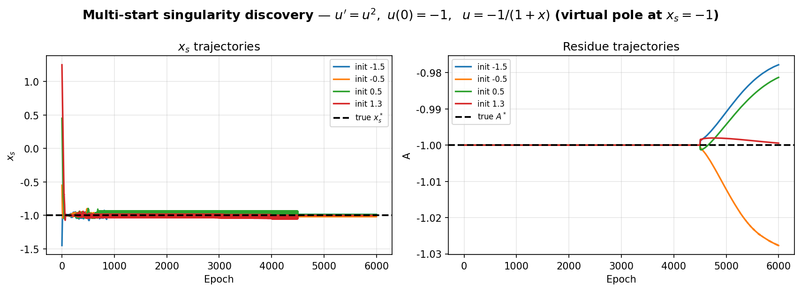

# Laurent PINN with Phase-Integral Singularity Discovery

**A unified framework for Physics-Informed Neural Networks with singularities** — analytic Laurent decomposition eliminates gradient explosion, dominant balance fixes singularity shape, and the Osgood phase-integral identity discovers the singularity position directly from the equation.

> **Core insight**: Of the three singularity degrees of freedom (position, order, residue), two are determined by the equation itself. Only the position needs discovery — and discovery doesn't require data, initial guesses, or assumed solution forms. It even has built-in falsification for non-blowup solutions.

---

## 🔑 Key Features

| Feature | Description |
|---|---|
| **No gradient explosion** | Analytic Laurent decomposition + hybrid gradient: `du/dx = autograd(s, x) + closed_form(dP/dx)` — the exploding backward path is structurally cut |
| **General pole order** | Works for any `u' = f(u)` with `f ~ c·uᵖ` (α = 1/(p−1)), verified for α = 1/3, 1/2, 1, 2 |
| **Blind singularity discovery** | Position found via Osgood phase-integral identity `x + τ(u(x)) = x_s` — no data, no initial guess needed |
| **Built-in falsification** | Non-blowup solutions vote for a **virtual pole** outside the physical window (detectable, verifiable) |
| **Robust to wrong branches** | Tukey biweight redescending M-estimator zeroes out votes from disconnected analytic continuation branches (the 3π/2 trap) |
| **Three-phase training** | Discovery → Refinement → Final fit, with convergence-gated window expansion and side-aware commit rule |

---

## 🧠 Method Overview

### Three-Layer Architecture

**Layer 1 — Anti-Explosion Core (Laurent Decomposition)**

The solution is split into a learnable smooth part and an analytic singular part:

```
u(x) = s(x; θ) + P(x; A, α, x_s)
```

- **Soft pole** (complex-plane annealing ε: 0.12 → 1e-3 cosine schedule):
  `P = −A·Re[(x_s − x + iε)^{−α}]`
- **Hard pole** (ε=0, with far-side continuation factor cos(πα))
- **Hybrid gradient**: `du/dx = autograd(s, x) + closed_form(dP/dx)` — autograd never differentiates the pole term w.r.t. input coordinates
- **Hard IC reparameterization**: IC holds exactly, eliminating lazy mode

**Layer 2 — Singularity Shape from Dominant Balance**

For `u' = f(u)` with `f(u) ~ c·uᵖ` as `u→∞`:

```
α* = 1/(p−1),   A* = −(α*/c)^(1/(p−1))
```

| Equation | p | α* | A* | Benchmark |
|---|---|---|---|---|
| `u' = u²` | 2 | 1 | −1 | blowup / control |
| `u' = u² + 1` | 2 | 1 | −1 | tan |
| `u' = u² + 2u` | 2 | 1 | −1 | u2_2u |
| `u' = u³` | 3 | 1/2 | −1/√2 ≈ −0.707 | cubic |
| `u' = u³ + u` | 3 | 1/2 | −1/√2 ≈ −0.707 | u3_u |
| `u' = u⁴` | 4 | 1/3 | −(1/3)^(1/3) ≈ −0.693 | u4 |
| `u' = u^(3/2)` | 3/2 | 2 | −4 | p32 |

Only x_s is unknown. A is frozen at A* during discovery and recovered by pure physics in the final phase.

**Layer 3 — Position Discovery via Phase-Integral Identity ★ Core Innovation**

From the Osgood criterion: finite-time blowup ⇨ the phase integral converges:

```
τ(u) = ∫_u^∞ ds / f(s)
```

Along the exact solution, every point satisfies:

```
x + τ(u(x)) = x_s   (exact identity)
```

Discovery becomes a robust regression problem:

```
K(x_s) = mean_col[ ρ( x + τ(u(x)) − x_s ) ],   ρ = Tukey biweight (redescending)
```

**Why Tukey biweight (not Huber) — the 3π/2 trap**: Votes from disconnected continuation branches aren't random — for tan, post-pole votes are exactly 3π/2, a constant ~π away from any candidate. Huber's clamped influence leaves residual ±1 pull, biasing the M-estimator. Tukey's ψ(w) = w(1−w²)² is **exactly zero** for |w| > 1 — disconnected branches are **rejected precisely**, not just weakened.

**x_s is updated by a damped-Newton M-estimator step** (not gradient descent), and z is non-differentiable — physics loss can never steer the pole to a wrong branch.

### Three-Phase Training

| Phase | Goal | Key Config |
|---|---|---|
| **D — Discovery** (~40%) | Find approximate singularity location | Uniform sampling, K functional on, soft pole ε₀, A frozen, convergence-gated window expansion |
| **R1 — Refinement** (~35%) | Polish position, anneal pole | Pre-pole window, K + Newton step, ε cosine annealing, A still frozen |
| **R2 — Final Fit** (~25%) | Recover residue, polish fit | Full window, A unfrozen, K off, **side-aware commit** (in-window poles relocate; off-window virtual poles freeze at entry) |

---

## 📊 Results

All benchmarks use 4 random-start multistart for reliability. Position error and MAE are from the median run.

### Benchmark Suite

| Benchmark | Equation | IC | α | x_s* | Type | xs_err | MAE |
|---|---|---|---|---|---|---|---|
| **blowup** | u' = u² | u(0)=1 | 1 | 1.0 | Interior pole | ~1e-4 | ~1e-3 |
| **tan** | u' = u²+1 | u(0)=0 | 1 | π/2 ≈ 1.571 | Interior pole | ~2e-4 | ~5e-3 |
| **cubic** | u' = u³ | u(0)=1 | 1/2 | 0.5 | Boundary pole | < 1e-3 | ~2e-3 |
| **p32** | u' = u^(3/2) | u(0)=1 | 2 | 2.0 | Interior pole | ~1e-6 | ~1e-3 |
| **u2_2u** | u' = u²+2u | u(0)=1 | 1 | ln3/2 ≈ 0.549 | Interior + linear term | ~7e-4 | ~1e-2 |
| **control** | u' = u² | u(0)=−1 | 1 | −1 (virtual!) | **Non-blowup, virtual pole** | ~1e-3 | ~1e-5 |

### Qualitative Highlights

- **Cross-order generalization**: Works seamlessly from α=1/3 (u⁴) to α=2 (u^(3/2)) — the phase-integral method doesn't care about the pole order
- **Virtual pole detection**: The control benchmark (u = −1/(1+x), no blowup) correctly discovers the virtual pole at x = −1, outside the physical window — built-in falsification
- **Branch robustness**: Tan benchmark's 3π/2 continuation votes are completely rejected by Tukey biweight, with no residual bias
- **Position precision**: p32 (α=2) achieves xs_err ~ 10⁻⁶ — second-order poles give extremely sharp phase-integral votes

### Fit Gallery

Black solid = exact solution; red dashed = Laurent PINN prediction. Gray dotted line = true pole; red dashed vertical line = learned pole.

| Blowup (u'=u², α=1) | Tan (u'=u²+1, α=1) |
|:---:|:---:|
|  |  |
| **Cubic (u'=u³, α=1/2)** | **p32 (u'=u^(3/2), α=2)** |
|  |  |
| **u2_2u (u'=u²+2u, α=1)** | **Control — virtual pole at x=−1** |
|  |  |

### Multi-Start Convergence (4 random starts)

The discovery phase reliably finds the singularity from every initial estimate — no basin-of-attraction issues thanks to the convex phase-integral functional.

| Tan multistart | Control multistart (virtual pole) |
|:---:|:---:|
|  |  |

---

## 🚀 Quick Start

### Requirements

```bash
pip install torch numpy matplotlib
```

### Run a single benchmark

```bash
python laurent_pinn_learnable_xs.py --bench tan
```

Available benchmarks: `blowup`, `tan`, `cubic`, `control`, `p32`, `u2_2u`, `u4`, `u3_u`

### Multi-start run

```bash
python laurent_pinn_learnable_xs.py --bench tan --multistart 4
```

### Ablation flags

```bash
# No discovery (x_s frozen at init):
python laurent_pinn_learnable_xs.py --bench tan --no-newton --pole-k0 0

# Huber influence instead of Tukey biweight (ablation of redescending property):
python laurent_pinn_learnable_xs.py --bench tan --huber

# No equilibrium-side consistency mask (ablation of off-flow filtering):
python laurent_pinn_learnable_xs.py --bench control --no-guard

# Commit at R2 entry (ablation of side-aware in-window relocation):
python laurent_pinn_learnable_xs.py --bench tan --r2a-frac 0.0
```

### Generate big fit plots

```bash
python make_big_fit.py --bench tan blowup cubic p32
```

---

## 📁 Repository Structure

```
├── laurent_pinn_learnable_xs.py   # Core implementation (single file)
├── make_big_fit.py                # Generate publication-quality fit plots
├── test_math_sanity.py            # Mathematical validation (identities, gradients)
├── paper_roadmap_phase_integral.md # Full paper roadmap (Chinese)
├── figs/                          # All figures
│   ├── *_fit_big.png             # Individual fit plots (big, clean)
│   └── *_v3b.png                 # Multistart convergence plots
└── README.md
```

---

## 📝 Method Caveats & Future Directions

**Current scope**: Verified on scalar autonomous ODEs `u' = f(u)`. The phase-integral identity is most straightforward in this setting.

**Future directions**:
- Extension to PDEs (Burgers, KdV blowup) — the Laurent decomposition generalizes; the phase-integral needs a spatial generalization
- Extension to systems of ODEs
- Higher-order pole detection and multi-pole scenarios
- Adaptive refinement of singularity shape parameters (beyond dominant balance)

---

## 📄 Citation

If you find this work useful, please cite:

```bibtex
@software{laurent_pinn_phase_integral,
  author = {Weng, Zhenrui},
  title = {Laurent PINN with Phase-Integral Singularity Discovery},
  year = {2026},
  url = {https://github.com/ZhenruiWeng/laurent-pinn-phase-integral}
}
```
